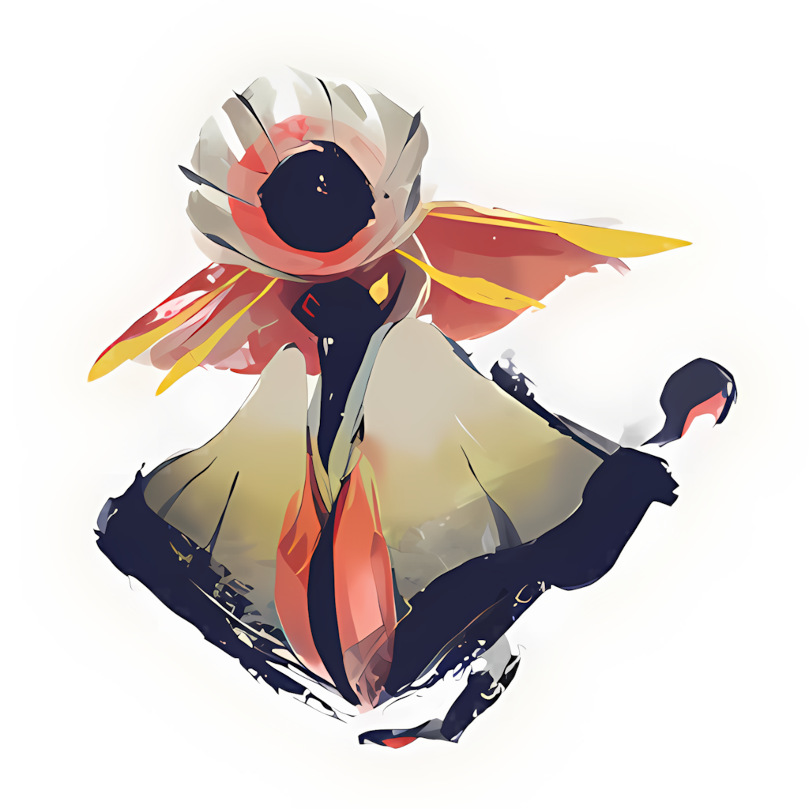
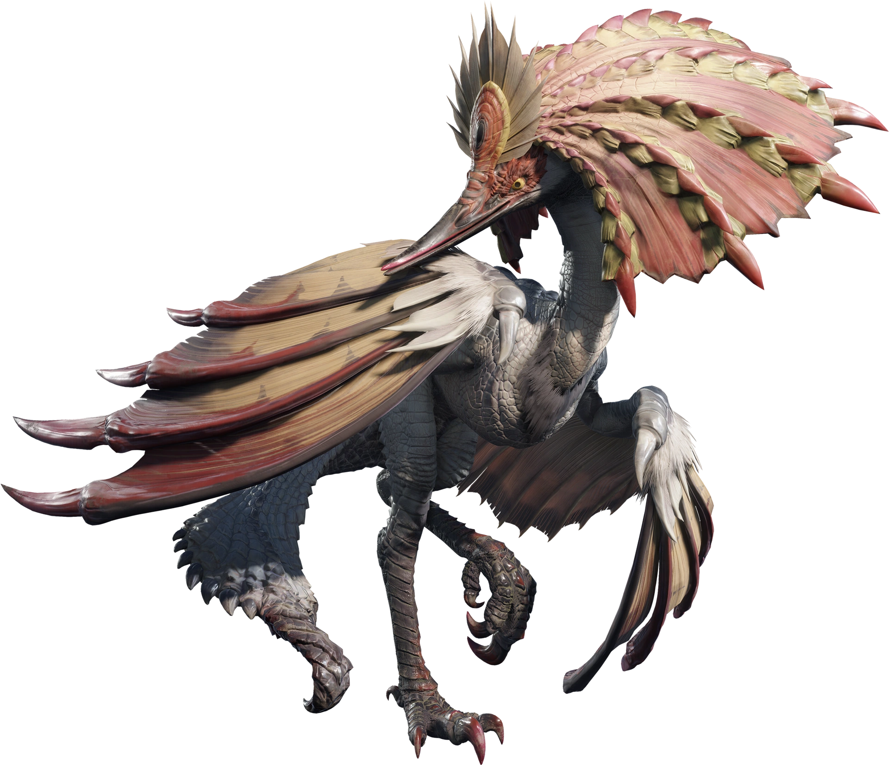
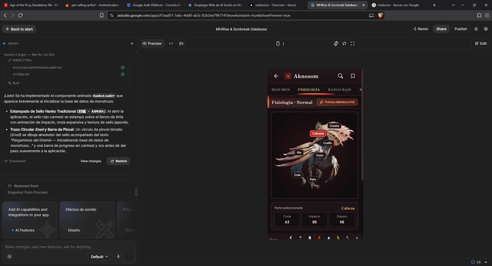
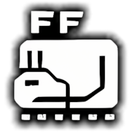
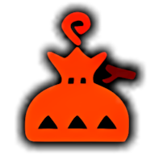
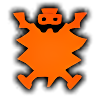
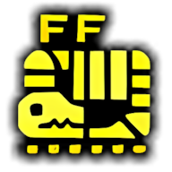
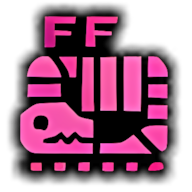
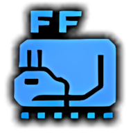
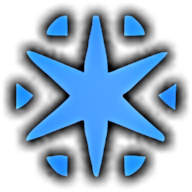

<div align="center">


<br />

<a href="https://mhrise.ai.studio" target="_blank">
  
</a>
<a href="https://mhrise.ai.studio" target="_blank">
  
</a>


<br /><br />

<p align="center">
  <b>Enciclopedia interactiva y base de datos de consulta ultrarrápida para <i>Monster Hunter Rise &amp; Sunbreak</i>.</b><br />
  Diseñada con estética de pergaminos japoneses <i>Sumi-e</i>, optimizada tanto para dispositivos móviles como para PC, con soporte completo sin conexión (PWA).
</p>

<p align="center">
  <a href="https://mhrise.ai.studio"><b>🌐 Visitar mhrise.ai.studio</b></a> ·
  <a href="#-características-principales"><b>✨ Características</b></a> ·
  <a href="#-vista-previa-y-arte-visual"><b>🖼️ Vista Previa</b></a> ·
  <a href="#-instalación-y-desarrollo-local"><b>🛠️ Instalación</b></a>
</p>

</div>


## 🏮 Sobre el Proyecto

**MHRise & Sunbreak Database** nace con un objetivo claro: ofrecer a los cazadores una herramienta de consulta **instantánea, limpia y sin distracciones** durante sus misiones.

Inspirada en el arte de tinta tradicional japonesa (**Sumi-e**), laca *Urushi* (`#110E10`), rojo carmesí de la Aldea Kamura (`#C92A2A`) y detalles en hoja de oro imperial (`#F2C96D`), la aplicación organiza toda la información crítica de cada monstruo —desde sus puntos débiles por parte corporal hasta las probabilidades exactas de obtención de materiales en **Rango Bajo, Rango Alto y Rango Maestro**— a un solo toque de distancia.

> 🔗 **Acceso directo a la versión pública:** [**https://mhrise.ai.studio**](https://mhrise.ai.studio)


## ✨ Características Principales

| Característica | Descripción |
| :--- | :--- |
| 🎨 **Arte Visual *Sumi-e* & Kamura** | Interfaz inspirada en los pergaminos del Gremio con trazos de pincel caligráfico (*Fude*), sellos tradicionales *Hanko* (`狩` / `竜`) y marcos ornamentales en oro y laca oscura. |
| ⭐ **Nivel de Peligro de 10 Estrellas** | Barra visual con trazo de tinta junto al nombre de cada monstruo que representa la escala oficial de amenaza de *MHRise & Sunbreak* (estrellas activas iluminadas en oro e inactivas en gris ceniza). |
| ⚔️ **Fisiología Interactiva + Render 3D** | Mapa anatómico interactivo sobre el render oficial del monstruo con pines seleccionables y tabla 100% ajustada a pantalla móvil (sin scroll horizontal) para daño de **Corte**, **Impacto**, **Disparo** y los **5 Elementos**. |
| ❤️ **Calculadora de Vida (1 a 4 Jugadores)** | Selector rápido de puntos de vida (*HP*) escalados para **1, 2, 3 y 4 jugadores** en Rango Bajo, Rango Alto y Rango Maestro, junto con los tamaños de corona mínima y máxima. |
| 💎 **Drops Unificados por Rango** | Tablas depuradas para **Rango Bajo**, **Rango Alto** y **Rango Maestro** divididas en *Recompensa de caza*, *Recompensa de captura*, *Recompensa por parte rota*, *Despiece* y *Materiales caídos y montura*, con porcentajes desglosados e iconos de materiales en alta definición. |
| 🔍 **Búsqueda Instantánea y Favoritos** | Buscador inteligente que localiza tanto **monstruos** como **materiales específicos** (indicando qué monstruo los suelta y en qué rango), además de filtro de monstruos guardados en favoritos. |
| 📱 **PWA Instalable y Navegación Móvil** | Aplicación Web Progresiva (*Progressive Web App*) 100% funcional sin conexión a internet, con soporte nativo para el gesto de retroceso en móviles y protección contra menús contextuales accidentales al mantener pulsadas las imágenes. |


## 🖼️ Vista Previa y Arte Visual

<div align="center">

<table>
  <tr>
    <td align="center" width="33%">
      <br />
      
      <br /><br />
      <b>Iconos de Gremio en Alta Definición</b><br />
      <sub>Arte oficial estilo <i>Sumi-e</i> enmarcado en laca y oro</sub>
      <br /><br />
    </td>
    <td align="center" width="33%">
      <br />
      
      <br /><br />
      <b>Render 3D &amp; Anatomía Interactiva</b><br />
      <sub>Visor ampliable con zoom táctil y puntos débiles</sub>
      <br /><br />
    </td>
    <td align="center" width="33%">
      <br />
      
      <br /><br />
      <b>Diseño Mobile-First sin Scroll Horizontal</b><br />
      <sub>Consulta rápida de zonas de impacto y elementos</sub>
      <br /><br />
    </td>
  </tr>
</table>

### 🎒 Catálogo de Iconos Reutilizables de Materiales y Elementos

<p align="center">
  
  &nbsp;
  
  &nbsp;
  
  &nbsp;
  
  &nbsp;
  
  &nbsp;
  
  &nbsp;
  
  &nbsp;
  
  &nbsp;
  
</p>

<p align="center">
  
  &nbsp;&nbsp;
  
  &nbsp;&nbsp;
  
  &nbsp;&nbsp;
  
  &nbsp;&nbsp;
  
  &nbsp;&nbsp;
  
  &nbsp;&nbsp;
  
  &nbsp;&nbsp;
  
  &nbsp;&nbsp;
  
  &nbsp;&nbsp;
  
</p>

</div>


## 🗂️ Estructura de Datos por Monstruo

Cada monstruo dentro de la base de datos cuenta con cinco pestañas dedicadas de acceso inmediato:

1. **RESUMEN**:
   - Nombre oficial, especie, **barra de peligro de 10 estrellas** e icono caligráfico.
   - Tabla comparativa de **Debilidades Elementales** (*Fuego, Agua, Rayo, Hielo, Draco*) y **Estados Alterados** (*Veneno, Sueño, Parálisis, Nitro, Aturdimiento*) en escala de 0 a 3 estrellas.
   - **Estados / Rugidos / Plagas** que aplica el monstruo.
   - **Tamaño Mínimo y Máximo** de corona, visor de **Render Oficial** a pantalla completa y selector de **Puntos de Vida (HP)** para 1, 2, 3 y 4 jugadores.
2. **FISIOLOGÍA**:
   - Render interactivo con marcadores sobre cada parte del cuerpo (*Cabeza, Cresta, Cuello, Torso, Ala, Pata, Cola*).
   - Botón para resaltar automáticamente los **Puntos débiles (`≥45`)** y tabla numérica completa de absorción de daño físico y elemental.
3. **RANGO BAJO / RANGO ALTO / RANGO MAESTRO**:
   - Desglose clasificado en **Recompensa de caza**, **Recompensa de captura**, **Recompensa por parte rota** (unificando partes como `Cola 100% / Pico 30%`), **Despiece** y **Materiales caídos y montura** (`Montura 70% / Caído 35%`).


## 🛠️ Instalación y Desarrollo Local

Si deseas clonar este repositorio y ejecutar la aplicación en tu entorno local:

```bash
# 1. Clonar el repositorio
git clone https://github.com/TU_USUARIO/TU_REPOSITORIO.git
cd TU_REPOSITORIO

# 2. Instalar dependencias
npm install

# 3. Iniciar el servidor de desarrollo (puerto 3000)
npm run dev

# 4. Compilar para producción (incluye Service Worker y manifiesto PWA)
npm run build
```

### Stack Tecnológico
- **Frontend**: React 19 + TypeScript
- **Estilos**: Tailwind CSS 4 + Diseño personalizado *Sumi-e* (`Shippori Mincho`, `Plus Jakarta Sans`, `JetBrains Mono`)
- **Empaquetado y PWA**: Vite 6 + `vite-plugin-pwa` (Workbox offline caching)
- **Iconografía**: Iconos vectoriales oficiales de elementos/estados y catálogo reutilizable de materiales en alta resolución


<div align="center">

### 🌐 Prueba la Aplicación Ahora

<a href="https://mhrise.ai.studio" target="_blank">
  
</a>

<br /><br />

<sub>Proyecto desarrollado con dedicación para la comunidad hispanohablante de <b>Monster Hunter Rise &amp; Sunbreak</b>.<br /><i>Monster Hunter Rise</i> y <i>Monster Hunter Rise: Sunbreak</i> son marcas registradas de CAPCOM CO., LTD.</sub>

</div>
