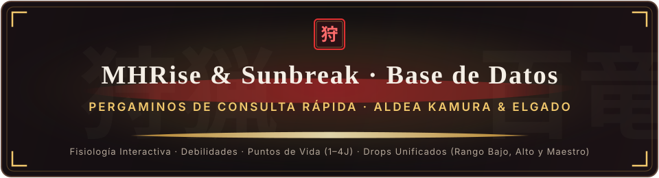
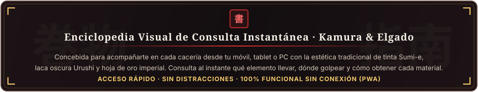
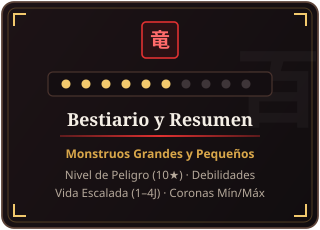
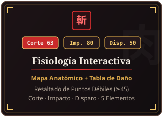
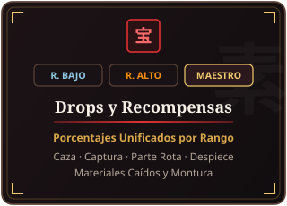
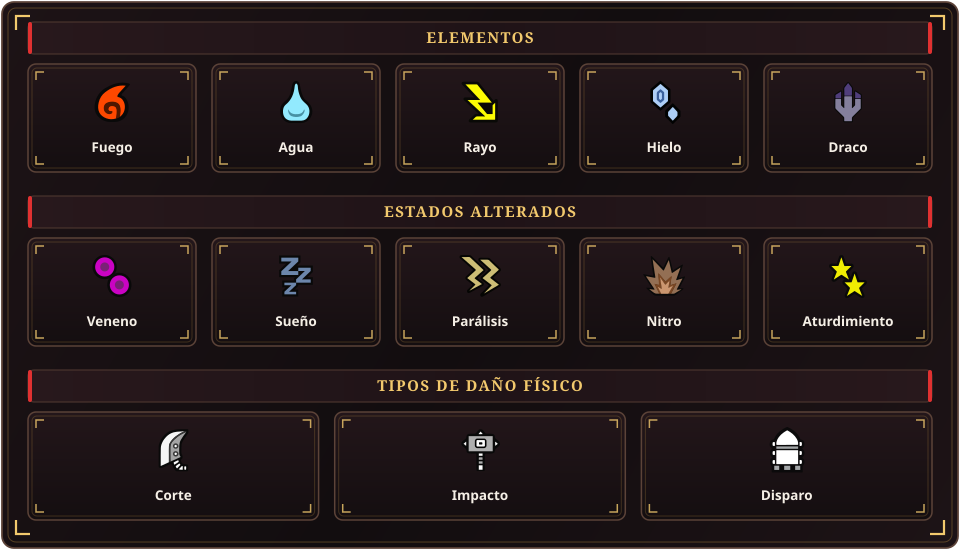
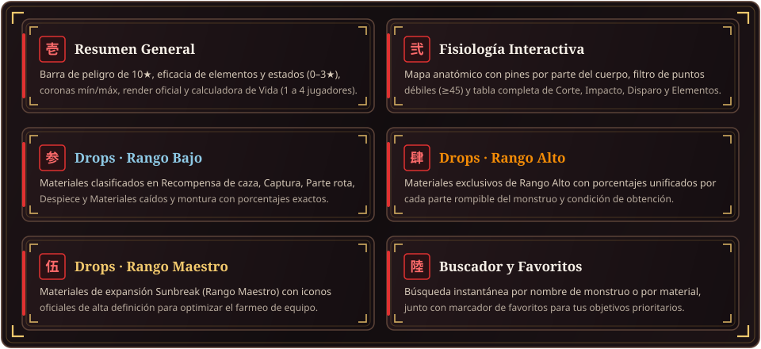
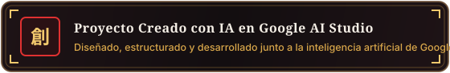

 

  

  <a href="https://mhrise.ai.studio"><b>🌐 Entrar a mhrise.ai.studio</b></a> ·
  <a href="#-el-pergamino-definitivo-del-cazador"><b>📜 El Pergamino</b></a> ·
  <a href="#-pilares-de-la-enciclopedia"><b>🏮 Pilares</b></a> ·
  <a href="#-iconos-usados"><b>⚡ Iconos Usados</b></a> ·
  <a href="#-guía-de-secciones-por-monstruo"><b>🗂️ Guía de Secciones</b></a>

## 📜 El Pergamino Definitivo del Cazador

  

## 🏮 Pilares de la Enciclopedia

<table>
  <tr>
    <td align="center" width="33%">
      
    </td>
    <td align="center" width="33%">
      
    </td>
    <td align="center" width="33%">
      
    </td>
  </tr>
</table>

## ⚡ Iconos Usados

  

## 🗂️ Guía de Secciones por Monstruo

  

### 🌐 Explora la Enciclopedia en Vivo

  

  

Desarrollado con dedicación para la comunidad hispanohablante de <b>Monster Hunter Rise &amp; Sunbreak</b>. <i>Monster Hunter Rise</i> y <i>Monster Hunter Rise: Sunbreak</i> son marcas registradas de CAPCOM CO., LTD.

