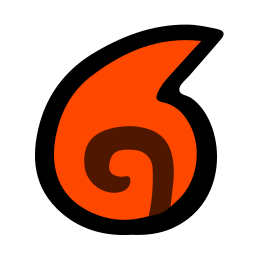
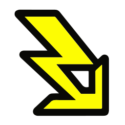
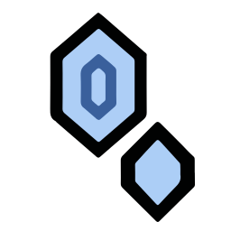
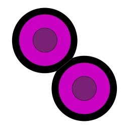
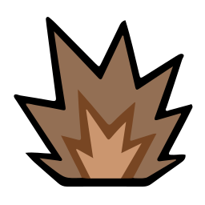
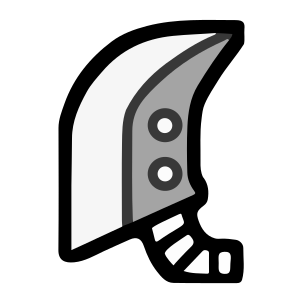
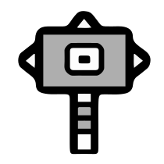
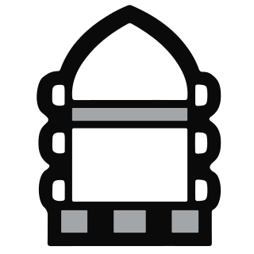

 

  

  <b>El pergamino interactivo de consulta rápida para los cazadores de <i>Monster Hunter Rise &amp; Sunbreak</i>.</b> 
  Explora debilidades, fisiología por zonas de impacto, puntos de vida escalados y probabilidades de materiales para todos los monstruos de la Aldea Kamura y la Avanzada de Elgado.

  <a href="https://mhrise.ai.studio"><b>🌐 Entrar a mhrise.ai.studio</b></a> ·
  <a href="#-pilares-de-la-enciclopedia"><b>🏮 Pilares</b></a> ·
  <a href="#-sistema-elemental-estados-y-daño"><b>⚡ Elementos y Estados</b></a> ·
  <a href="#-guía-de-secciones-por-monstruo"><b>📜 Secciones</b></a>

## 📜 El Pergamino Definitivo del Cazador

**MHRise & Sunbreak · Base de Datos** es una enciclopedia visual concebida para acompañarte en cada misión desde tu teléfono móvil, tablet o PC.

Su interfaz rinde homenaje al arte tradicional japonés de tinta (**Sumi-e**), combinando fondos de laca oscura *Urushi*, trazos de pincel en rojo carmesí de Kamura y acabados en hoja de oro imperial. Cada pantalla ha sido diseñada para que encuentres **en cuestión de segundos** exactamente qué arma o elemento llevar, dónde golpear a cada monstruo y cómo obtener cada material.

> 🔗 **Accede a la aplicación web:** [**https://mhrise.ai.studio**](https://mhrise.ai.studio)

## 🏮 Pilares de la Enciclopedia

<table>
  <tr>
    <td align="center" width="33%">
      
    </td>
    <td align="center" width="33%">
      
    </td>
    <td align="center" width="33%">
      
    </td>
  </tr>
</table>

## ⚡ Sistema Elemental, Estados y Daño

La base de datos integra la iconografía de combate para identificar al instante las vulnerabilidades físicas, elementales y de estados alterados de cada monstruo del bestiario:

<table>
  <tr>
    <th align="center" colspan="5">🔥 Elementos</th>
  </tr>
  <tr>
    <td align="center" width="20%">
       
       
      <b>Fuego</b>
        
    </td>
    <td align="center" width="20%">
       
       
      <b>Agua</b>
        
    </td>
    <td align="center" width="20%">
       
       
      <b>Rayo</b>
        
    </td>
    <td align="center" width="20%">
       
       
      <b>Hielo</b>
        
    </td>
    <td align="center" width="20%">
       
       
      <b>Draco</b>
        
    </td>
  </tr>
  <tr>
    <th align="center" colspan="5">🧪 Estados Alterados</th>
  </tr>
  <tr>
    <td align="center" width="20%">
       
       
      <b>Veneno</b>
        
    </td>
    <td align="center" width="20%">
       
       
      <b>Sueño</b>
        
    </td>
    <td align="center" width="20%">
       
       
      <b>Parálisis</b>
        
    </td>
    <td align="center" width="20%">
       
       
      <b>Nitro</b>
        
    </td>
    <td align="center" width="20%">
       
       
      <b>Aturdimiento</b>
        
    </td>
  </tr>
</table>

<table>
  <tr>
    <th align="center" colspan="3">⚔️ Tipos de Daño Físico (Fisiología)</th>
  </tr>
  <tr>
    <td align="center" width="33%">
       
       
      <b>Corte</b>
        
    </td>
    <td align="center" width="33%">
       
       
      <b>Impacto</b>
        
    </td>
    <td align="center" width="33%">
       
       
      <b>Disparo</b>
        
    </td>
  </tr>
</table>

## 📜 Guía de Secciones por Monstruo

| Sección | Contenido Detallado |
| :--- | :--- |
| 🏮 **Resumen** | Identidad del monstruo, **barra visual de peligro de 10 estrellas**, eficacia de elementos y estados alterados (0 a 3 ★), rugidos/plagas, tamaños de **Corona Mínima y Máxima**, render oficial ampliable y calculadora de **Puntos de Vida (HP)** para **1, 2, 3 y 4 jugadores**. |
| 🎯 **Fisiología** | Mapa anatómico interactivo con marcadores sobre cada parte del cuerpo, filtro inteligente para resaltar **Puntos débiles (`≥45`)** y tabla completa de valores de absorción para **Corte**, **Impacto**, **Disparo** y los **5 Elementos**. |
| 🥉 **Rango Bajo** | Probabilidades de obtención clasificadas en **Recompensa de caza**, **Recompensa de captura**, **Recompensa por parte rota**, **Despiece** y **Materiales caídos y montura**. |
| 🥈 **Rango Alto** | Materiales exclusivos de Rango Alto con porcentajes unificados por parte rota y condición de caída. |
| 🥇 **Rango Maestro** | Materiales de *Sunbreak* (Rango Maestro) organizados para facilitar el farmeo de equipo de alto nivel. |
| 🔍 **Buscador y Favoritos** | Búsqueda instantánea tanto por **nombre de monstruo** como por **nombre de material**, más marcador de favoritos para tener siempre a mano tus objetivos de caza. |

### 🌐 Explora la Enciclopedia en Vivo

  

  

Desarrollado con dedicación para la comunidad hispanohablante de <b>Monster Hunter Rise &amp; Sunbreak</b>. <i>Monster Hunter Rise</i> y <i>Monster Hunter Rise: Sunbreak</i> son marcas registradas de CAPCOM CO., LTD.

